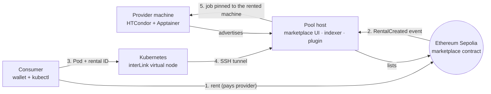

# Web3 Rent Computers

**Rent a computer with a wallet tap. Run your Kubernetes workload on it with one `kubectl apply`.**
A provider lists an idle machine on Ethereum, a consumer pays for it straight from a wallet, and a Kubernetes Pod runs on *exactly that machine*
(Ethereum → interLink → HTCondor → Apptainer). Airbnb for idle computers, live on Sepolia today. W3Node 2026 Hackathon · Track: Real World Assets (RWA) · Ethan Le Roux (`Megaguy32`)

> Demo video: _add link here_ · Quickstart: [QUICKSTART.md](QUICKSTART.md)

## Why

Cloud compute in Africa is expensive and high-latency: servers sit overseas and bill in USD. Meanwhile local PCs, gaming rigs and lab
computers sit idle for hours every day. We turn that idle hardware into rentable, on-chain-priced compute: no credit card, no credit check,
no new tooling. The rented machine shows up as a node in the Kubernetes cluster you already run.

**Providers:** PC owners, computer labs. **Renters:** local developers, cluster administrators, AI/3D builders who need cheap compute.

## How it works



1. The provider machine joins an HTCondor pool and is **listed on-chain** with a price and duration.
2. A consumer **rents it** from the marketplace UI (one wallet transaction, paid straight to the provider).
3. The marketplace indexes the rental. The consumer submits a normal **Pod annotated with the rental ID** to Kubernetes.
4. interLink forwards the Pod to a patched HTCondor plugin that **validates the rental and pins the job** to the rented machine.
5. The provider runs it in an Apptainer container; logs and status flow back to `kubectl`.

## What we built

A working marketplace, running end to end on **Ethereum Sepolia** with real VMs and real Kubernetes. Nothing below is mocked.

| Area | Status |
|---|---|
| Marketplace contract (list, update, rent, direct payment) | Deployed and exercised on Sepolia; Foundry tests |
| Go indexer + web UI + **Live view** (machine tiles, on-chain feed) | Working; unit tests |
| Patched `interlink-htcondor-plugin` (rental validation, provider pinning) | Proven against the real upstream plugin and a real HTCondor pool |
| Pinning across two real providers (container + KVM VM) | Proven: the job ran only on the rented machine |
| Kubernetes consumer (Minikube KVM2) through an SSH tunnel | Working |
| Observability: Grafana fleet counters (ready / pending / live), CPU and RAM, Cockpit VM view | Working |
| Reboot-proof bring-up (`scripts/demo-up.sh`) | One command brings the whole stack up from cold in ~90 s |
| Scripted, recorded demo (`demo/`) | Working |

## Quickstart

```bash
cd marketplace-v2 && ./scripts/check.sh                               # Go tests, plugin patcher tests, syntax checks (no infrastructure)
forge install foundry-rs/forge-std && forge test -vv                  # original contract, from the repo root
```

The full single-laptop demo (Minikube + provider VMs + Sepolia) is in **[QUICKSTART.md](QUICKSTART.md)**.

## Repository map

| Path | What it is |
|---|---|
| `contracts/ComputerRWA.sol`, `test/` | The original concept contract: tokenised machines with escrow |
| `marketplace-v2/` | The working implementation: contract, Go indexer/UI, plugin patcher, scripts, demo tooling |
| `marketplace-v2/docs/` | Architecture, manual deployment, reboot-proof bring-up, demo runbooks, security notes |
| `QUICKSTART.md` | Zero-to-demo guide, plus troubleshooting from real failures |

## Roadmap

We proved the hard part first: *a wallet payment really results in a workload running on a specific machine.* Next is the full design,
already drafted in `contracts/ComputerRWA.sol`: an ERC-721 token per physical computer recording its specs and hourly rate, **escrowed**
payment for the booked hours, container/SSH access during the lease, and **uptime-based settlement** (pay the owner on completion, refund the
renter on downtime). A real-world asset here is tangible hardware that does measurable work; tying a machine's specs and leases to a contract
turns idle hardware into an income-producing on-chain asset.

## Scope and next steps

- **Testnet today:** deployed on Sepolia; mainnet follows an audit.
- **Payments go straight to the provider.** Escrow, refunds and overlap protection are the next milestone (designed in `ComputerRWA.sol`).
- **Trust model:** the pool runs on a trusted network (`CLAIMTOBE`) and proof of machine ownership is planned. Details in
  [marketplace-v2/docs/SECURITY_AND_LIMITATIONS.md](marketplace-v2/docs/SECURITY_AND_LIMITATIONS.md).
- The hackathon demo listings are deactivated, so nothing is for rent right now. Bring the stack up and list your own machine.
