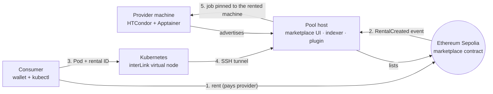

# Web3 Rent Computers

**Rent idle computers on Ethereum and run your Kubernetes workloads on them.**
A provider lists a machine on-chain, a consumer pays for it with a wallet, and a Kubernetes Pod runs on *exactly that machine*
(Ethereum → interLink → HTCondor → Apptainer). W3Node 2026 Hackathon · Track: Real World Assets (RWA) · Ethan Le Roux (`Megaguy32`)

> Demo video: _add link here_ · Quickstart: [QUICKSTART.md](QUICKSTART.md)

## Why

Cloud compute in Africa is expensive and high-latency: servers sit overseas and bill in USD. Meanwhile local PCs, gaming rigs and lab
computers sit idle for hours every day. This project turns that idle hardware into rentable, on-chain-priced compute, with no credit card
and no credit check, usable from the Kubernetes tooling people already have.

**Providers:** PC owners, computer labs. **Renters:** local developers, cluster administrators, AI/3D builders who need cheap compute.

## How it works



1. The provider machine joins an HTCondor pool and is **listed on-chain** with a price and duration.
2. A consumer **rents it** from the marketplace UI (one wallet transaction, paid straight to the provider).
3. The marketplace indexes the rental. The consumer submits a normal **Pod annotated with the rental ID** to Kubernetes.
4. interLink forwards the Pod to a patched HTCondor plugin that **validates the rental and pins the job** to the rented machine.
5. The provider runs it in an Apptainer container; logs and status flow back to `kubectl`.

## What is built (and verified)

Demonstrated end to end on **Ethereum Sepolia**, on one laptop with real VMs. Everything below was run, not mocked.

| Area | Status |
|---|---|
| Marketplace contract (list, update, rent, direct payment) | Deployed and exercised on Sepolia; Foundry tests |
| Go indexer + web UI + **Live view** (machine tiles, on-chain feed) | Working; unit tests |
| Patched `interlink-htcondor-plugin` (rental validation, provider pinning) | Verified against the real upstream plugin and a real HTCondor pool |
| Pinning across two real providers (container + KVM VM) | Verified: the job ran only on the rented machine |
| Kubernetes consumer (Minikube KVM2) through an SSH tunnel | Working |
| Observability: Grafana fleet counters (ready / pending / live), CPU and RAM, Cockpit VM view | Working |
| Reboot-proof bring-up (`scripts/demo-up.sh`) | Cold bring-up from a fully stopped stack in ~90 s; **not yet tested across a real host reboot** |
| Scripted, recorded demo (`demo/`) | Working |

## Quickstart

```bash
cd marketplace-v2 && ./scripts/check.sh                               # Go tests, plugin patcher tests, syntax checks (no infrastructure)
forge install foundry-rs/forge-std && forge test -vv                  # original contract, from the repo root
```

The full single-laptop demo (Minikube + provider VMs + Sepolia) is in **[QUICKSTART.md](QUICKSTART.md)**.

## Repository map

| Path | What it is |
|---|---|
| `contracts/ComputerRWA.sol`, `test/` | The original concept contract: tokenised machines with escrow |
| `marketplace-v2/` | The working implementation: contract, Go indexer/UI, plugin patcher, scripts, demo tooling |
| `marketplace-v2/docs/` | Architecture, manual deployment, reboot-proof bring-up, demo runbooks, security notes |
| `QUICKSTART.md` | Zero-to-demo guide, plus troubleshooting from real failures |

## Concept: where this is heading

The original design (kept in `contracts/ComputerRWA.sol`) goes further than the prototype: an ERC-721 token per physical computer recording its
specs and hourly rate, **escrowed** payment for the booked hours, container/SSH access during the lease, and **uptime-based settlement**
(pay the owner on completion, refund the renter on downtime). `marketplace-v2` deliberately skips escrow, staking and tokenomics to prove the hard
part first: *a wallet payment really results in a workload running on a specific machine.* A real-world asset here is tangible hardware that does
measurable work; linking a machine's specs and leases to a contract turns idle hardware into an on-chain asset.

## Limits (read before relying on it)

- Demo-grade security: the HTCondor pool uses `CLAIMTOBE` authentication on a trusted network; workloads are trusted. See
  [marketplace-v2/docs/SECURITY_AND_LIMITATIONS.md](marketplace-v2/docs/SECURITY_AND_LIMITATIONS.md).
- No escrow or refunds in `marketplace-v2`; overlapping rentals of one machine are possible; nothing proves a provider controls the machine it lists.
- Sepolia testnet only. The contract is unaudited.
- The demo listings from the hackathon have been deactivated, so nothing is currently for rent.
