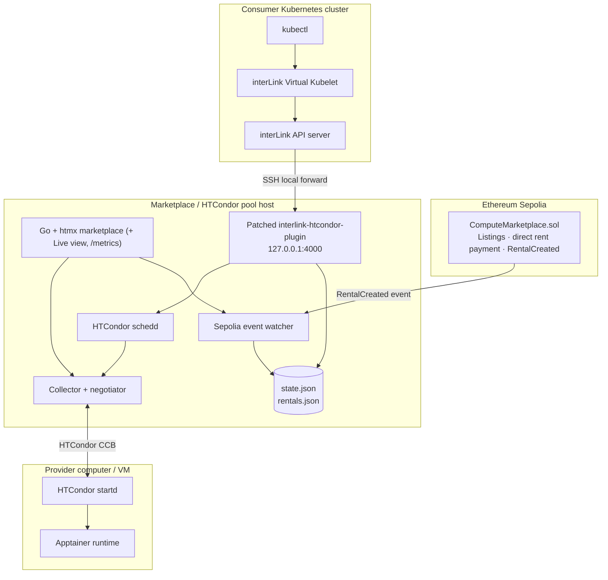

# marketplace-v2: the working implementation

A controlled hackathon prototype for renting real HTCondor compute through an Ethereum Sepolia marketplace and consuming it from Kubernetes
through interLink. **Core proof:** a Kubernetes Pod with a marketplace rental ID is submitted through interLink, converted into an HTCondor job,
pinned to the rented provider machine, and executed there with Apptainer.

Start with the repo-level [QUICKSTART](../QUICKSTART.md). This page is the map of what is in here. **[Pitch video (2:49) and 60 s live demo](https://github.com/Megaguy32/hackathon-w3node-2026---web3-rent-computers/releases/tag/v1.0.0)**.

## Architecture

## Documentation

| Doc | Use it for |
|---|---|
| [../QUICKSTART.md](../QUICKSTART.md) | Zero to a working demo on one laptop; troubleshooting |
| [docs/REBOOT_PROOF.md](docs/REBOOT_PROOF.md) | `demo-up.sh` / `demo-down.sh` and what survives a reboot |
| [docs/MANUAL_DEPLOYMENT.md](docs/MANUAL_DEPLOYMENT.md) | Separate pool host, providers and consumer (the original step-by-step guide) |
| [docs/LOCAL_LAPTOP_DEMO.md](docs/LOCAL_LAPTOP_DEMO.md) | The Minikube/KVM2 consumer helper in detail (`demo-laptop.sh`) |
| [docs/DEMO_RUNBOOK.md](docs/DEMO_RUNBOOK.md) | Rehearsal results and the gotchas found on real Sepolia |
| [docs/VIDEO_DEMO_3MIN.md](docs/VIDEO_DEMO_3MIN.md), [demo/README.md](demo/README.md) | Recording the demo (manual run-sheet and the automated conductor) |
| [docs/SECURITY_AND_LIMITATIONS.md](docs/SECURITY_AND_LIMITATIONS.md) | What this does not protect against |
| [docs/ARCHITECTURE.md](docs/ARCHITECTURE.md), [docs/CONSOLIDATION_NOTES.md](docs/CONSOLIDATION_NOTES.md) | Design notes and why parts were chosen |

## Components

| Path | What it is |
|---|---|
| `contracts/` | Solidity marketplace contract, Foundry deploy script and tests |
| `marketplace/` | Standard-library Go backend: htmx UI, **Live view** (`/live`), Sepolia event watcher, HTCondor discovery, rental-state mirror, Prometheus `/metrics` |
| `plugin/` | Guarded patcher for upstream `interlink-htcondor-plugin` (fails closed if upstream anchors move) |
| `infrastructure/docker/` | Compose stack: pool host (HTCondor + patched plugin + marketplace), hardened sshd, node exporter |
| `infrastructure/` (rest) | HTCondor configs, systemd units, provider scripts, tunnel-user and firewall helpers |
| `consumer/interlink/` | interLink tunnel/API/virtual-kubelet startup scripts and configs |
| `scripts/` | `demo-up.sh`, `demo-down.sh`, `demo-preflight.sh`, `demo-laptop.sh`, `provider-vm.sh` (golden-image VMs), `chain-actions.sh`, `check.sh` |
| `observability/` | Grafana dashboard (fleet counters, pod phases, CPU/RAM) |
| `demo/` | Selenium conductor + ffmpeg edit pipeline for the recorded demo |
| `examples/` | Demo Pods (`compute-pod.yaml`, `compute-pod-load.yaml`) and a manual HTCondor job |

## Prototype boundaries

This is a **controlled hackathon prototype**, not a production cloud service. It assumes known participants and trusted demo workloads. The demo
HTCondor configuration uses `CLAIMTOBE` authentication and must stay on an isolated network. No escrow, staking, refunds, DAO, tokenomics, GPU,
metering or general-purpose cloud features are implemented.
