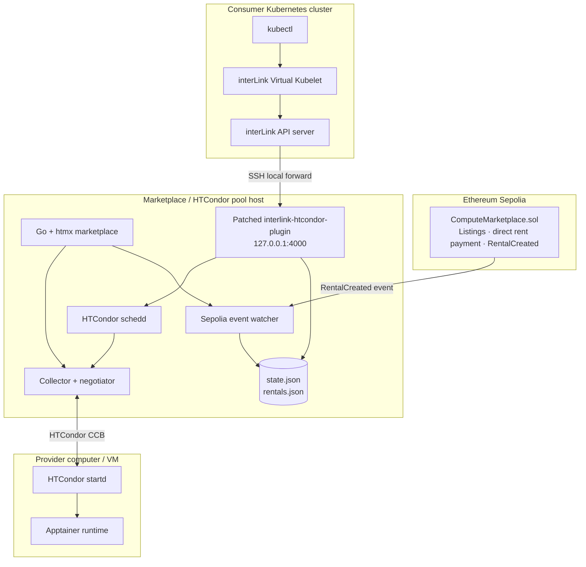

# W3Node Decentralised Compute Marketplace

A hackathon prototype for renting real HTCondor compute capacity through an Ethereum Sepolia marketplace and consuming it from an existing Kubernetes cluster through interLink.

**Core proof:** a Kubernetes Pod with a marketplace rental ID is submitted through interLink, converted into an HTCondor job, pinned to the rented provider machine, and executed there with Apptainer.

> Recording a demo? Start with `./scripts/demo-preflight.sh` and follow [docs/VIDEO_DEMO_3MIN.md](docs/VIDEO_DEMO_3MIN.md).

## Architecture



## What is included

- `contracts/`: Solidity marketplace, Foundry deployment script and tests.
- `marketplace/`: standard-library Go backend, htmx UI, Sepolia event watcher, HTCondor node discovery and rental-state mirror.
- `plugin/`: guarded patcher for upstream `interlink-htcondor-plugin` plus install helper and sidecar config.
- `infrastructure/`: demo-only HTCondor configuration, systemd units, provider compatibility shim, pool firewall helper and host install scripts.
- `consumer/interlink/`: interLink tunneled-mode configuration and startup helpers. The startup helper recognizes current upstream `bin/vk` as well as older `bin/virtual-kubelet` builds.
- `examples/`: Kubernetes Pod and manual HTCondor test job.
- `scripts/demo-laptop.sh`: KVM2 Minikube consumer setup, interLink build/connect, optional local provider VM, and optional Grafana install.
- `observability/`: optional Kubernetes/Grafana dashboard and monitoring notes.
- `docs/VIDEO_DEMO_STORYBOARD.md`: factual capture sequence for the demo video.
- `docs/CONSOLIDATION_NOTES.md`: implementation choices made while merging the two candidate repositories.
- `dist/marketplace-linux-amd64`: prebuilt Linux x86-64 backend binary.

## Prototype boundaries

This is a **controlled hackathon prototype**, not a production cloud service. It assumes known participants and trusted demo workloads. The demo HTCondor configuration uses `CLAIMTOBE`, which does not authenticate peers. Keep the pool port restricted to known provider source addresses. The rental ID annotation is an identifier, not a cryptographic proof of wallet identity. A rental is checked when a Pod is submitted; a running job is not automatically terminated at expiry.

No escrow, staking, refunds, DAO, tokenomics, GPU, metering or general-purpose cloud features are implemented.

## Prerequisites

### Marketplace / pool host

- Linux host with a public DNS name or reachable public IP.
- HTCondor installed from the official HTCondor package repository.
- Go 1.23+ to build from source, or use the included x86-64 binary on a compatible Linux host.
- Python 3, `git`, `nftables`, `systemd`.
- An SSH account for the consumer's interLink tunnel.
- A Sepolia JSON-RPC URL.

### Provider machine

- Linux host or VM; use a native installation rather than nesting Apptainer inside Docker.
- HTCondor installed from the official package repository.
- Apptainer installed and working.
- Outbound connectivity to the pool host on TCP/9618. The pool host must allow the provider's public egress address.

### Consumer

- A working Kubernetes cluster and `kubectl`.
- interLink binaries built from a release compatible with the HTCondor plugin, including `interlink` and `vk` (`ssh-tunnel` only for the optional `interlink-ssh-tunnel` mode) (some older builds call the latter `virtual-kubelet`).
- SSH private key accepted by the marketplace host.
- MetaMask or another injected Ethereum wallet funded with Sepolia ETH.

## Build and verify locally

From the project root:

```bash
./scripts/check.sh
./scripts/build.sh
```

The Go backend and plugin patcher tests are runnable locally. Solidity tests require Foundry and `forge-std` (the deployment script installs `forge-std` if missing). No live chain deployment or real HTCondor/interLink end-to-end test has been performed from the packaging environment.


## Local laptop demo: KVM2 Minikube

The laptop helper prepares a KVM2-backed Minikube consumer cluster and builds/starts the local interLink components. It can optionally create an Ubuntu KVM provider VM on the same laptop and connect that VM to the **existing remote Marketplace/HTCondor pool host** using CCB. The Marketplace/Pool host remains a prerequisite; this script does not bootstrap another pool host.

```bash
cp .demo-laptop.env.example .demo-laptop.env
# Edit SSH host/user/key, InterLink checkout path, and optional provider pool hostname.
./scripts/demo-laptop.sh doctor
./scripts/demo-laptop.sh install-deps
# Log out/in if libvirt group membership was added, then:
./scripts/demo-laptop.sh up
./scripts/demo-laptop.sh build-interlink
./scripts/demo-laptop.sh connect
```

Optional local provider VM:

```bash
./scripts/demo-laptop.sh provider-up
./scripts/demo-laptop.sh provider-status
```

The remote pool firewall must allow the laptop's public egress IP on TCP/9618. Use `./scripts/demo-laptop.sh marketplace-ui` to forward the remote UI to `http://127.0.0.1:8080`. After renting a listing, run the Pod with the resulting rental ID:

```bash
./scripts/demo-laptop.sh run <rental-id>
./scripts/demo-laptop.sh watch
./scripts/demo-laptop.sh logs
```

Optional Grafana dashboard:

```bash
./scripts/demo-laptop.sh monitoring
# In another terminal:
./scripts/demo-laptop.sh grafana
```

See [docs/LOCAL_LAPTOP_DEMO.md](docs/LOCAL_LAPTOP_DEMO.md) for the full workflow, VM details, cleanup commands and troubleshooting. See [observability/README.md](observability/README.md) for what the dashboard measures and what it does not measure.

## 1. Configure the HTCondor pool host

Install HTCondor using the official repository for your Linux distribution. Then, as an admin user:

```bash
export POOL_HOSTNAME=pool.example.net
./infrastructure/scripts/configure-pool.sh
```

Apply the firewall allowlist. Use the provider's **public egress IP**, not its RFC1918 LAN address:

```bash
sudo PROVIDER_PUBLIC_IPV4=203.0.113.20 ./infrastructure/scripts/restrict-pool-port.sh
```

Optional IPv6 allowlist: set `PROVIDER_PUBLIC_IPV6` as well. These nftables rules are runtime-only; add equivalent rules to your persistent firewall configuration after the demo setup is verified. Do not open TCP/9618 to the world.

## 2. Configure the provider machine

Install HTCondor and Apptainer natively. Then:

```bash
export POOL_HOSTNAME=pool.example.net
./infrastructure/scripts/configure-provider.sh
```

The provider script installs `/usr/local/bin/singularity` as a compatibility shim to `/usr/bin/apptainer`, because the current upstream HTCondor plugin invokes the `singularity` command in its generated job script. Verify:

```bash
singularity --version
apptainer --version
condor_status -af Machine Name State HasSingularity
```

The pool host should show the provider machine. Confirm the machine name exactly; that value becomes the listing's `machineName` and the `TARGET.Machine` requirement.

## 3. Install the marketplace host application

On the pool host, unpack this project and run:

```bash
sudo ./infrastructure/scripts/install-marketplace-host.sh
```

Edit `/etc/w3node-marketplace.env` and set:

```dotenv
RPC_URL=https://YOUR_SEPOLIA_RPC_ENDPOINT
CHAIN_ID=11155111
CONTRACT_ADDRESS=0xYOUR_DEPLOYED_CONTRACT
START_BLOCK=YOUR_CONTRACT_DEPLOYMENT_BLOCK
```

The backend defaults to `127.0.0.1:8080`. Access it from your workstation through SSH port forwarding:

```bash
ssh -L 8080:127.0.0.1:8080 user@pool.example.net
```

Then open `http://127.0.0.1:8080` in a browser with MetaMask installed.

**Event indexing:** the backend starts scanning at `START_BLOCK`. Set it to the deployment block if listings/rentals may have been created before the backend starts. If it is `0`, the first startup begins at the current chain head; start the backend before registering the first listing.

## 4. Deploy the smart contract to Sepolia

Install Foundry, then from `contracts/`:

```bash
export SEPOLIA_RPC_URL=https://YOUR_SEPOLIA_RPC_ENDPOINT
export PRIVATE_KEY=YOUR_TESTNET_DEPLOYER_PRIVATE_KEY
./deploy-sepolia.sh
```

Use a dedicated testnet wallet only. Never commit a private key or put it in the project archive. Record the deployed contract address and deployment block, then update `/etc/w3node-marketplace.env` and restart the backend:

```bash
sudo systemctl restart w3node-marketplace
```

The contract transfers native Sepolia ETH directly to the provider when `rent()` succeeds. It does not implement escrow.

## 5. Install and run the patched HTCondor plugin

On the pool host, from the unpacked project directory, run as a normal user with `sudo` available:

```bash
./plugin/install-plugin.sh
sudo install -m 0644 infrastructure/systemd/w3node-plugin.service /etc/systemd/system/
sudo systemctl daemon-reload
sudo systemctl enable --now w3node-plugin
sudo systemctl status w3node-plugin
```

The installer clones the upstream plugin's `main` branch, installs Flask/PyYAML into a virtual environment, applies the guarded source patch and compiles `handles.py`. The patcher makes a backup and refuses to patch if source anchors differ. It also binds the plugin to loopback and disables Flask debug mode; the consumer accesses it through the interLink SSH tunnel.

If the upstream source has changed, the patcher will stop rather than guessing. Inspect the new source and update the patch intentionally.

The backend writes `/run/w3node/rentals.json` (created by `RuntimeDirectory=w3node` in both units, preserved across restarts); the plugin reads the same file. The systemd services both run as `w3node` on the pool host.

## 6. Configure interLink on the consumer side

Build/download interLink 0.6.x binaries compatible with the plugin and place them in `~/src/interLink/bin/`. The official tunneled deployment pattern is documented here: <https://interlink-project.dev/docs/cookbook/tunneled>.

The supplied configs are in `consumer/interlink/`. On the consumer machine:

```bash
export INTERLINK_DIR="$HOME/src/interLink"
export MARKETPLACE_SSH_ADDR=pool.example.net:22
export MARKETPLACE_SSH_USER=interlink-tunnel
export SSH_KEY="$HOME/.ssh/interlink_rsa"
export SSH_HOST_KEY_FILE="$HOME/.ssh/interlink_host_key" # recommended
```

On the pool host, create the restricted tunnel account once (no shell, can only forward to the plugin port) and reload sshd:

```bash
sudo infrastructure/scripts/create-tunnel-user.sh /path/to/interlink_rsa.pub 4000
sudo systemctl reload sshd
```

The tunnel script disables SSH connection multiplexing on purpose: a `ControlMaster`/`ControlPersist` entry in
`~/.ssh/config` would otherwise leave the forward running after `disconnect` and skip host-key pinning.
If `127.0.0.1:4000` is already taken on the consumer machine, set `PLUGIN_LOCAL_PORT` (for example `4001`);
both the tunnel and `start-api-and-vk.sh` honour it.

Run these in separate terminals, in this order:

```bash
./consumer/interlink/start-ssh-tunnel.sh
```

```bash
export KUBECONFIG="$HOME/.kube/config"
./consumer/interlink/start-api-and-vk.sh
```

The tunnel uses the local Unix socket path configured in `InterLinkConfig.yaml` and forwards it over SSH to the plugin's loopback TCP/4000. Do not expose port 4000 publicly. Use a dedicated SSH key/user for the tunnel and verify the server host key.

Check the virtual node:

```bash
kubectl get nodes
```

The node name in the provided Pod manifest is `interlink-node`. Adjust the manifest only if you deliberately change `--nodename`.

## 7. Run the demo Pod

First publish a provider listing from the marketplace UI. Wait for the backend to index `ListingCreated`. Then rent that listing from a different wallet. Wait for `RentalCreated` to appear in the UI. Copy the returned rental ID into `examples/compute-pod.yaml`:

```yaml
metadata:
  annotations:
    marketplace.w3node.io/rental-id: "1"
```

Submit it:

```bash
kubectl apply -f examples/compute-pod.yaml
kubectl get pods -w
kubectl logs w3node-compute-demo
```

On the provider, watch `htop` or `condor_q`. The Pod's output includes its execution hostname, which should match the rented HTCondor `Machine`.

The provided Pod uses CPU requests and limits because the current plugin derives HTCondor request values from resource limits. It uses a small Alpine image; pre-pull/cache it on the provider if demo network latency is a concern.

If `kubectl logs` fails in the tunneled interLink setup, check for pending CSRs:

```bash
kubectl get csr
kubectl certificate approve <csr-name>
```

## Useful commands

```bash
# Pool/provider discovery
condor_status -af Machine Name State Cpus Memory HasSingularity

# Queue
condor_q -better-analyze
condor_q -long

# Service logs on pool host
sudo journalctl -u w3node-marketplace -f
sudo journalctl -u w3node-plugin -f

# Backend health
curl http://127.0.0.1:8080/healthz

# Plugin health (on pool host)
curl -X GET --data '[]' http://127.0.0.1:4000/status
```

## Known limitations

- One HTCondor pool, one provider machine and one consumer cluster are the intended first demo.
- The prototype's rental annotation is not a cryptographic identity assertion. It is acceptable only with trusted demo participants and a protected interLink/plugin path.
- Rental expiry is checked at Pod submission; it does not kill a job that started before expiry.
- Direct payment is final; there is no escrow or refund mechanism.
- No service networking, persistent Kubernetes service, or general-purpose PVC guarantee is provided by the batch execution plugin.
- The Go event listener uses JSON-RPC polling and a local cursor file, not a production indexing service.
- `START_BLOCK` must cover the contract events you expect the backend to index.
- `HasSingularity` availability depends on HTCondor and Apptainer configuration. Inspect the actual ClassAd before relying on UI availability.

## Sources

- HTCondor: <https://htcondor.readthedocs.io/>
- HTCondor networking / CCB: <https://htcondor.readthedocs.io/en/latest/admin-manual/networking.html>
- interLink tunneled deployment: <https://interlink-project.dev/docs/cookbook/tunneled>
- interLink: <https://github.com/interlink-hq/interLink>
- HTCondor plugin: <https://github.com/interlink-hq/interlink-htcondor-plugin>
- Foundry: <https://book.getfoundry.sh/>
