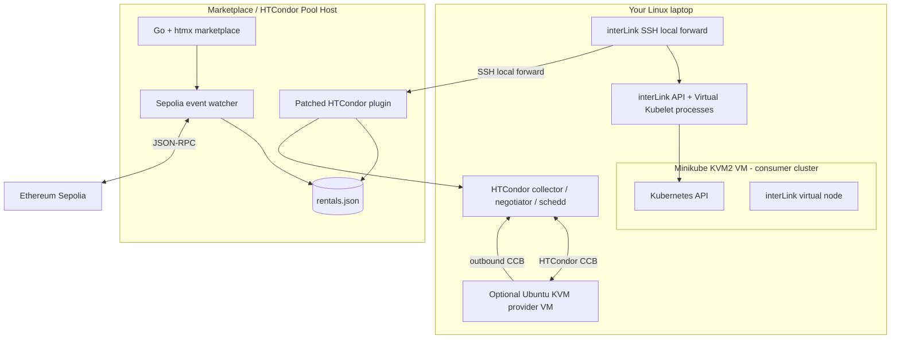

# Local laptop demo: KVM2 Minikube consumer + optional KVM provider

This helper prepares the **consumer side** on a Linux laptop using Minikube's KVM2 driver. It can also create an Ubuntu provider VM on the same laptop and have that VM join your existing HTCondor pool over CCB.

It deliberately does **not** create a second Marketplace/Pool host. The Marketplace/Pool host must already be deployed and running the patched `interlink-htcondor-plugin`. That host is where the HTCondor collector/negotiator/schedd, plugin, Go marketplace backend, Sepolia watcher and rental state file live. Keeping that host pre-provisioned makes the laptop rehearsal repeatable and avoids building an extra cloud VM management system into the demo script.

## Topology



The optional provider VM is useful when you only have one laptop available to act as the provider. It is still a VM on your laptop, not a separate physical host. For a stronger judge demo, a second physical machine is preferable.

## Requirements

- Linux x86-64 with hardware virtualization enabled and `/dev/kvm` available.
- A working libvirt system connection (`qemu:///system`).
- Minikube KVM2 driver and `kubectl`.
- Git, Go and `make` to build interLink.
- SSH access to the Marketplace/Pool host.
- A funded Sepolia wallet and a deployed contract.
- A Marketplace/Pool host already configured according to the main README.

Minikube's KVM2 driver uses libvirt and QEMU/KVM. Run `virt-host-validate qemu` if startup fails. If your user was just added to the `libvirt` group, log out and back in before continuing.

## 1. Configure the demo

```bash
cp .demo-laptop.env.example .demo-laptop.env
$EDITOR .demo-laptop.env
```

At minimum set:

```dotenv
MARKETPLACE_SSH_ADDR=pool.example.net:22
MARKETPLACE_SSH_USER=interlink-tunnel
SSH_KEY=$HOME/.ssh/interlink_rsa
SSH_HOST_KEY_FILE=$HOME/.ssh/interlink_host_key
INTERLINK_DIR=$HOME/src/interLink
```

Keep `.demo-laptop.env` private. Do not put private keys, RPC credentials or wallet secrets in it. The SSH private key should only grant access to the dedicated tunnel account.

## 2. Check KVM and install local prerequisites

```bash
./scripts/demo-laptop.sh doctor
./scripts/demo-laptop.sh install-deps
```

The installer supports Arch/EndeavourOS, Debian/Ubuntu and Fedora. Review package manager prompts before accepting them. If group membership changes, log out and back in, then run `doctor` again.

## 3. Create the Minikube consumer cluster

```bash
./scripts/demo-laptop.sh up
```

This creates a Minikube profile named `w3node-demo` by default, using `--driver=kvm2`, and enables `metrics-server` and standard storage add-ons. It does not change the default Minikube profile.

## 4. Build interLink

```bash
./scripts/demo-laptop.sh build-interlink
```

By default this clones/updates the upstream `main` branch and builds its current targets. The helper expects `bin/interlink`, `bin/vk` and `bin/ssh-tunnel`. For a reproducible hackathon rehearsal, pin `INTERLINK_REF` to a tested tag or commit in `.demo-laptop.env` after the plugin compatibility check is complete.

## 5. Connect the consumer cluster to the remote plugin

```bash
./scripts/demo-laptop.sh connect
```

This starts:

1. The interLink SSH local forward from the laptop to the Marketplace/Pool host's loopback plugin port.
2. The interLink API server.
3. The Virtual Kubelet process, pointed at the `w3node-demo` Minikube kubeconfig.

Check:

```bash
./scripts/demo-laptop.sh status
kubectl --context w3node-demo get nodes -o wide
```

The `interlink-node` should appear. Inspect `.demo-state/logs/` if it does not.

## 6. Optional: create a provider VM on the same laptop

This is optional. It creates an Ubuntu 26.04 cloud-image VM on libvirt's `default` NAT network, installs HTCondor and Apptainer, and configures the execute daemon to join the **existing remote pool** using CCB.

Set `POOL_HOSTNAME` in `.demo-laptop.env`, then:

```bash
./scripts/demo-laptop.sh provider-up
./scripts/demo-laptop.sh provider-status
```

Before starting the guest, allowlist the laptop's public egress IP on the remote Marketplace/Pool host firewall for TCP/9618. The script prints this IP at startup; use the main README's firewall procedure. The provider guest needs outbound connectivity to the pool host; do not open inbound ports on the guest.

Cloud-init files and the SSH key are stored under `.demo-state/provider/`. The downloaded base image is cached there and copied into `PROVIDER_VM_DIR` (default `/var/lib/libvirt/images/w3node`) for libvirt; the VM overlay disk is stored in that libvirt directory. `provider-down` undefines the VM but preserves its disk and base image. Remove the `w3node` image directory and `.demo-state/provider/` manually when you want to delete the VM data.

For a provider on a second physical machine, skip this step and configure that machine using the main README instead.

## 7. Open the marketplace UI

In another terminal:

```bash
./scripts/demo-laptop.sh marketplace-ui
```

Open <http://127.0.0.1:8080>. This SSH-forwards the remote Marketplace/Pool host's loopback port 8080. Register the provider listing and rent it with MetaMask as described in the main README.

## 8. Submit the Kubernetes workload

After the backend has indexed the `RentalCreated` event, use the returned rental ID:

```bash
./scripts/demo-laptop.sh run 1
./scripts/demo-laptop.sh watch
./scripts/demo-laptop.sh logs
```

The helper renders a copy of `examples/compute-pod.yaml` into `.demo-state/manifests/` with the selected rental ID; it does not modify the checked-in example. On the provider, observe `condor_q` and the machine's process activity. The workload prints its execution hostname so you can verify that HTCondor placed it on the rented machine.

## 9. Optional Grafana dashboard

```bash
./scripts/demo-laptop.sh monitoring
```

In another terminal:

```bash
./scripts/demo-laptop.sh grafana
```

Open <http://127.0.0.1:3000> and sign in with `admin` and `GRAFANA_ADMIN_PASSWORD` from `.demo-laptop.env` (default `w3node-demo`). Change that password for anything beyond a local demo.

The included dashboard shows consumer-cluster state: interLink virtual-node readiness, Pod phase counts and Pod restarts. **It does not claim to measure the remote provider's CPU or memory usage.** Use `condor_q`, provider-side `htop`, and the marketplace UI to show actual execution. For richer traces, see [Observability](../observability/README.md).

## 10. Shut down

```bash
./scripts/demo-laptop.sh disconnect
./scripts/demo-laptop.sh down
```

`down` stops Minikube but retains its data. To delete the cluster:

```bash
./scripts/demo-laptop.sh destroy
```

The optional provider VM is separate; use `provider-down` to undefine it.

## Useful rehearsal layout

For a clear live presentation, arrange three terminal panes:

- Consumer: `kubectl get pods -w` and then `kubectl logs w3node-compute-demo`.
- Marketplace/pool: `condor_q -wide` and `journalctl -u w3node-marketplace -f`.
- Provider: `htop` or `watch -n 1 'condor_status -af Machine State Activity'`.

Show the Sepolia transaction in the marketplace/browser, then submit the Pod and show the same rental ID in its annotation. Avoid showing private keys, `.env` files, wallet seed phrases or SSH private keys in screen recordings.
